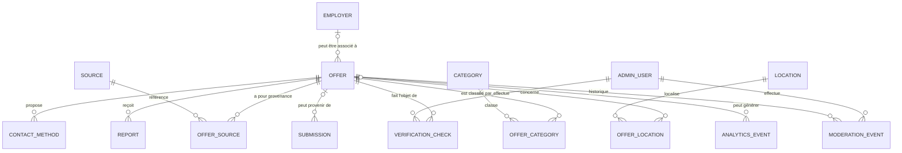

# Modèle conceptuel de données — plateforme d'opportunités professionnelles

**Version :** 0.1 — document de travail  
**Date :** 12 octobre 2026  
**Dépendances :** Spécification générale v0.1 ; Architecture fonctionnelle v0.1  
**Statut :** proposition conceptuelle à relire avant le schéma technique de la base de données

> Ce document décrit les grandes données métier, leurs relations et les règles à préserver. Il ne constitue pas encore un schéma SQL définitif et ne choisit aucune technologie.

## 1. Pourquoi définir le modèle de données maintenant ?

Le modèle conceptuel précise quelles informations la plateforme doit retenir, pourquoi elles sont utiles et comment elles se relient. Il doit permettre de gérer les offres collectées manuellement, les offres soumises par des tiers, leur provenance, les contrôles effectués et les retours des visiteurs sans mélanger ces notions.

Le principe central est le suivant : **une offre, sa source, son état de publication et les vérifications qui la concernent sont des objets liés, mais distincts**.

## 2. Principes de modélisation

1. **Une fiche d'offre centrale.** Une annonce collectée manuellement et une annonce soumise par formulaire rejoignent le même catalogue après contrôle.
2. **Provenance traçable.** Une offre doit pouvoir être reliée à une ou plusieurs sources, y compris lorsqu'une même annonce apparaît sur plusieurs canaux.
3. **Aucun fait inventé.** Les informations absentes restent non renseignées ; elles ne sont pas remplacées par des valeurs supposées.
4. **Publication distincte de la vérification.** « Publiée » ne signifie pas automatiquement « employeur vérifié » ou « disponibilité confirmée ».
5. **Contact distinct de la source.** Le lien d'origine d'une annonce n'est pas nécessairement le canal de candidature.
6. **Compatible avec l'expansion régionale.** Le modèle doit pouvoir représenter différents pays, localités, devises et types d'opportunités sans refonte majeure.
7. **Collecter le minimum nécessaire.** Aucune fiche de candidat ni compte candidat n'est indispensable au MVP ; les données des visiteurs doivent être limitées.
8. **Historique raisonnable.** Les changements importants de statut et les contrôles doivent rester traçables afin d'expliquer les décisions éditoriales.

## 3. Vue d'ensemble des objets métier

| Objet | À quoi il sert | MVP ? |
|---|---|---|
| **Offre** | Contenu structuré visible sur le site | Oui |
| **Source** | Publication, page, site, émission ou autre origine où l'annonce a été repérée | Oui |
| **Lien offre-source** | Relier une offre à une ou plusieurs sources, ou une source à plusieurs offres | Oui |
| **Employeur** | Représenter une entreprise ou un recruteur lorsqu'il peut être identifié | Facultatif au départ |
| **Moyen de candidature** | Conserver WhatsApp, téléphone, email, URL externe ou dépôt physique | Oui |
| **Localisation** | Représenter pays, région, ville ou lieu de travail | Oui, forme simple possible au début |
| **Catégorie** | Classer les offres par métier, domaine ou type d'opportunité | Oui |
| **Soumission** | Conserver une proposition d'annonce reçue via un formulaire avant décision | Oui si le formulaire est activé |
| **Contrôle / vérification** | Garder la trace d'un contrôle de source, d'employeur, de disponibilité ou de contact | Oui |
| **Signalement** | Enregistrer un problème signalé par un visiteur | Oui |
| **Compte administrateur** | Identifier qui peut gérer les contenus et effectuer des contrôles | Oui |
| **Historique des actions** | Tracer les changements de statut et décisions importantes | Oui, version simple |
| **Événement analytique** | Mesurer vues, recherches, clics sortants et partages | Oui, de façon minimale |

Les objets peuvent être implémentés dans une seule base de données. Les distinguer ici clarifie les responsabilités ; cela ne demande pas de créer un service technique séparé pour chaque objet.

## 4. Description des objets principaux

### 4.1 Offre

**Rôle :** représenter une opportunité professionnelle unique dans le catalogue.

**Informations conceptuelles :**
- identifiant unique ;
- intitulé et description structurée ;
- type d'opportunité : emploi, stage, mission, apprentissage ou autre catégorie retenue ;
- type de contrat et régime de travail, lorsque connus ;
- employeur affiché dans l'annonce, si disponible ;
- lien facultatif vers une fiche Employeur identifiée ;
- localisation ou mode de travail (sur site, hybride, à distance, non précisé) ;
- rémunération : montant ou fourchette, devise, périodicité et état de divulgation ;
- expérience et qualifications requises, lorsque précisées ;
- dates utiles : date originale connue, collecte, publication, échéance éventuelle, dernière actualisation ;
- état de publication et état de disponibilité ;
- date de création et de dernière modification dans le système.

**À ne pas confondre :** une rémunération absente ne vaut pas zéro ; une date limite inconnue ne doit pas être inventée ; une annonce publiée n'est pas forcément encore ouverte.

### 4.2 Source

**Rôle :** décrire l'origine où une annonce a été trouvée : page Facebook, publication WhatsApp partageable, site d'emploi, site d'entreprise, émission radio ou autre canal.

**Informations conceptuelles :** type de source, nom affichable, URL si disponible, date de publication originale si connue, date de découverte/collecte, mode de collecte et notes internes sur les conditions de reprise ou l'autorisation éventuelle.

Une source peut exister sans URL, par exemple une émission radio. Dans ce cas, le nom du programme, la station et une date ou référence peuvent servir à documenter la provenance.

### 4.3 Lien offre-source

**Rôle :** relier les offres aux publications d'origine.

Une source peut mentionner plusieurs postes ; une offre peut aussi apparaître sur plusieurs sources. Une relation distincte permet de conserver ces deux situations sans dupliquer inutilement la fiche de l'offre.

Elle peut préciser le type de lien (source initiale, republication, confirmation complémentaire), les notes internes et la date d'association.

### 4.4 Employeur

**Rôle :** représenter une entreprise, une organisation, un cabinet ou, si le contexte l'exige, un recruteur individuel identifiable.

Une offre peut exister sans fiche Employeur structurée si l'identité n'est pas connue ou suffisamment vérifiée. Le nom tel qu'il apparaît dans la source peut être conservé séparément pour afficher fidèlement l'annonce originale, avec prudence lorsque l'identité est incertaine.

À terme, plusieurs offres pourront être liées à un même employeur. L'existence d'une fiche ne doit pas, à elle seule, lui conférer un badge de vérification.

### 4.5 Moyen de candidature

**Rôle :** indiquer au visiteur comment répondre à une offre.

Types possibles : WhatsApp, téléphone, email, formulaire ou site externe, dépôt physique, ou instructions de candidature par un autre moyen.

Pour chaque moyen : type, libellé, cible (numéro, adresse, URL ou lieu), instructions et ordre d'affichage. Une offre peut disposer de plusieurs moyens de candidature.

**Règle de confidentialité :** ne rendre public un numéro ou un autre contact que si la source l'indique comme canal destiné aux candidatures ou si l'autorisation nécessaire a été obtenue. Le contact pour postuler doit rester distinct du lien qui prouve la provenance de l'annonce.

### 4.6 Localisation

**Rôle :** permettre la recherche locale au Burkina et, ultérieurement, dans d'autres pays de la région.

Le modèle doit représenter au minimum le pays et la localité ; région/province et ville peuvent être ajoutées selon les informations disponibles. Une offre peut concerner plusieurs localités ou être à distance. Il ne faut donc pas présumer que chaque offre possède toujours une seule ville obligatoire.

Pour le MVP, une structure simple est acceptable, à condition d'éviter de mélanger le nom de ville, le pays et les indications de télétravail dans un seul champ libre difficile à filtrer.

### 4.7 Catégorie

**Rôle :** permettre de classer et filtrer les offres selon le métier, le domaine ou le type d'opportunité.

Une offre peut avoir une catégorie principale et, si cela apporte de la valeur, des catégories ou étiquettes secondaires. La liste doit pouvoir évoluer sans modifier le code à chaque ajout de métier.

Il faudra distinguer la nature de l'opportunité (emploi, stage, mission) de la famille de métier (vente, comptabilité, bâtiment, logistique, etc.).

### 4.8 Soumission

**Rôle :** enregistrer une annonce proposée via un formulaire public avant qu'elle devienne une offre publiée.

Elle conserve le contenu soumis, la date de réception, les coordonnées du soumetteur nécessaires au suivi, l'état de traitement et les notes de modération. Après contrôle, l'administrateur peut créer une offre à partir de cette soumission, demander une correction, la refuser ou la rattacher à une offre existante si elle constitue un doublon.

La soumission et l'offre publique restent conceptuellement distinctes : recevoir un formulaire ne signifie pas qu'une annonce est acceptée ou publiée.

### 4.9 Contrôle / vérification

**Rôle :** conserver la trace d'une vérification précise concernant une offre ou, plus tard, un employeur.

Chaque contrôle devrait enregistrer : type de contrôle, résultat, date, méthode ou éléments consultés, personne responsable et note interne proportionnée.

Exemples : source retrouvée ; identité de l'employeur confirmée ; disponibilité du poste confirmée ; moyen de contact testé. Le résultat doit pouvoir être « confirmé », « non confirmé », « invalidé » ou « contradictoire », selon les règles métier à définir.

Les marques visibles sont produites à partir de contrôles pertinents et récents. Il faut éviter de stocker un score arbitraire de confiance sans méthode explicable.

### 4.10 Signalement

**Rôle :** enregistrer les retours d'un visiteur sur une annonce : poste pourvu, offre expirée, informations incorrectes, contact injoignable, suspicion de fraude ou autre motif prévu.

Le signalement contient une offre concernée, un motif, une date, un état de traitement et éventuellement un commentaire. Les coordonnées du déclarant sont facultatives et ne sont pas publiques.

Un signalement ne doit pas automatiquement supprimer une offre par défaut ; il déclenche un examen selon les règles de modération.

### 4.11 Compte administrateur et historique des actions

**Rôle :** sécuriser l'accès interne et rendre les décisions importantes traçables.

Au MVP, un rôle d'administrateur peut suffire. Il faut néanmoins conserver une identité de compte distincte pour chaque personne ayant des accès, plutôt que partager un mot de passe commun. Si l'équipe s'agrandit, des rôles plus limités pourront être introduits.

L'historique peut enregistrer les principales transitions : qui a publié, fermé, modifié ou retiré une offre ; quand ; et, si nécessaire, pour quel motif. Il ne doit pas devenir une copie illimitée de chaque action sans utilité.

### 4.12 Événement analytique

**Rôle :** mesurer l'utilisation de la plateforme : consultation d'une fiche, recherche, clic vers le canal de candidature, partage ou signalement.

Les événements doivent être suffisamment sobres pour mesurer l'usage sans collecter des données personnelles superflues. Un clic WhatsApp signifie seulement qu'un lien a été ouvert depuis le site ; il ne prouve ni l'envoi d'un message, ni une candidature, ni un recrutement.

Les règles précises de conservation et d'anonymisation seront définies dans l'architecture technique et la politique de confidentialité.

## 5. Relations et cardinalités

*Lecture :* `||` indique un élément obligatoire du côté concerné ; `o{` indique zéro à plusieurs. Le diagramme présente une structure logique : la modélisation technique finale pourra ajuster certaines relations après les règles métier détaillées.

| Relation | Règle conceptuelle |
|---|---|
| Employeur → offres | Un employeur peut être lié à plusieurs offres ; une offre peut ne pas être liée à un employeur structuré. |
| Offre ↔ source | Relation plusieurs-à-plusieurs via le lien Offre-Source. |
| Offre → moyens de candidature | Une offre peut avoir zéro, un ou plusieurs moyens, mais une offre publiable doit disposer d'instructions de candidature suffisamment utiles. |
| Offre → contrôles | Une offre peut recevoir plusieurs contrôles dans le temps. |
| Offre → signalements | Une offre peut recevoir zéro ou plusieurs signalements. |
| Offre ↔ catégories | Une ou plusieurs classifications selon les règles de catégorisation retenues. |
| Offre ↔ localisations | Une ou plusieurs localisations, ou un mode à distance. |
| Soumission → offre | Une soumission peut être refusée ou produire/rejoindre une offre ; elle ne doit pas créer automatiquement une offre publique. |
| Administrateur → contrôles/actions | Chaque action administrative importante est attribuable à un compte autorisé. |

## 6. Statuts : ne pas tout mettre dans un seul champ

Le système doit séparer au moins trois dimensions.

### 6.1 État de publication

- `draft` — brouillon, non public ;
- `pending_review` — en attente de contrôle ;
- `published` — visible publiquement ;
- `rejected` — refusé après examen ;
- `closed` — ne doit plus être présenté comme une opportunité active ;
- `archived` — conservé à des fins d'historique, hors du catalogue actif.

### 6.2 État de disponibilité

- `unknown` — disponibilité inconnue ;
- `declared_open` — l'annonce indique que le poste est ouvert, sans confirmation directe récente ;
- `confirmed_open` — disponibilité confirmée selon la procédure retenue ;
- `filled` — poste pourvu selon une information fiable ;
- `withdrawn` — recruteur ou source indique que le recrutement est retiré.

L'expiration peut provenir d'une date limite dépassée, mais il faut définir la politique correspondante. Elle ne doit pas être déduite arbitrairement si aucune date n'est disponible.

### 6.3 Résultats des contrôles

Les contrôles ont leurs propres résultats et dates. « Source retrouvée », « employeur vérifié » et « disponibilité confirmée » ne sont pas synonymes et ne doivent pas être fusionnés en un seul badge opaque.

**Règle proposée :** la fraîcheur de l'annonce est calculée ou évaluée à partir des dates et des contrôles ; « à actualiser » est une alerte de traitement plutôt qu'un état de publication permanent. Ainsi, une annonce peut être publiée tout en nécessitant une reconfirmation, si la politique éditoriale l'autorise et si l'incertitude est clairement indiquée.

## 7. Règles métier à préserver

1. Une offre publique possède un identifiant interne stable et une URL publique stable tant qu'elle est publiée.
2. Un brouillon ou une soumission en attente n'est jamais visible dans le catalogue public.
3. Une offre doit avoir une provenance enregistrée, sauf exception explicitement autorisée par la politique éditoriale.
4. Le lien de source et le canal de candidature sont deux informations différentes.
5. Une annonce dupliquée doit être détectée et examinée avant de créer une nouvelle fiche publique ; la duplication peut toutefois être légitime si deux postes distincts sont concernés.
6. Les données inconnues restent nulles/non renseignées et sont affichées comme « non précisé » lorsque c'est pertinent.
7. Les contrôles doivent conserver une date et un résultat ; une vérification ancienne ne prouve pas automatiquement une disponibilité actuelle.
8. Une offre fermée ne doit plus apparaître parmi les opportunités actives.
9. Un signalement déclenche un examen ; sa gravité peut motiver une suspension selon une règle séparée à définir.
10. Les liens et coordonnées publics doivent être pertinents pour la candidature et conformes aux règles de confidentialité.
11. Les indicateurs analytiques ne doivent pas prétendre mesurer des candidatures abouties si la plateforme ne reçoit pas ces confirmations.
12. Les règles de publication doivent être modifiables sans reconstruire tout le modèle de données.

## 8. Périmètre de données du MVP

### À modéliser dès le départ

- Offre ;
- Source et lien Offre-Source ;
- Moyen de candidature ;
- Localisation et catégorie ;
- Employeur facultatif ou nom d'employeur tel que publié ;
- Soumission externe si le formulaire est lancé ;
- Contrôle/vérification ;
- Signalement ;
- Compte administrateur et événements de modération ;
- Événements analytiques élémentaires.

### À ne pas rendre obligatoires au MVP

- profil candidat ;
- compte employeur complet ;
- candidature déposée et suivie sur le site ;
- messagerie interne ;
- paiement et facturation ;
- score automatisé par IA ;
- recommandation personnalisée ;
- intégrations automatiques aux réseaux sociaux.

### Préparation à l'évolution

Les catégories, types d'opportunité, devises et localisations doivent être extensibles. En revanche, il n'est pas nécessaire de construire immédiatement des microservices ou une base de données distribuée. Une application bien structurée et une base de données cohérente suffisent pour le démarrage.

## 9. Décisions ouvertes à garder dans le registre du projet

Ces points ne bloquent pas la création du modèle conceptuel, mais ils doivent être décidés avant la conception technique définitive ou avant leur mise en production :

1. politique d'ancienneté et de reconfirmation des offres ;
2. règles exactes de publication des offres non reconfirmées ;
3. niveau d'identification exigé pour un employeur ou un soumetteur ;
4. sources autorisées pour la collecte et règles de retrait ;
5. vocabulaire définitif des catégories et types d'opportunités ;
6. durée de conservation des signalements, journaux et événements analytiques ;
7. nécessité de conserver certains contacts dans une fiche privée séparée des informations publiques.

**Hypothèses provisoires de cette version :** catalogue accessible sans compte ; collecte manuelle comme voie principale ; contrôle éditorial avant publication ; aucun système de candidature interne ni paiement au MVP.

## 10. Critères de validation avant le schéma technique

Le modèle conceptuel pourra être validé lorsque :

- chaque objet a un rôle compréhensible et non redondant ;
- les relations permettent une source multiple et des offres sans employeur formel identifié ;
- statut de publication, disponibilité et résultat de vérification sont séparés ;
- les canaux de candidature sont distingués des sources ;
- le parcours d'une soumission peut être tracé sans publication automatique ;
- les données personnelles et analytiques sont limitées au nécessaire ;
- les besoins du MVP sont représentés sans imposer les fonctions futures comme obligatoires.

## 11. Étape suivante

La suite sera de définir les parcours et les écrans, puis de finaliser le schéma technique avant le développement.
